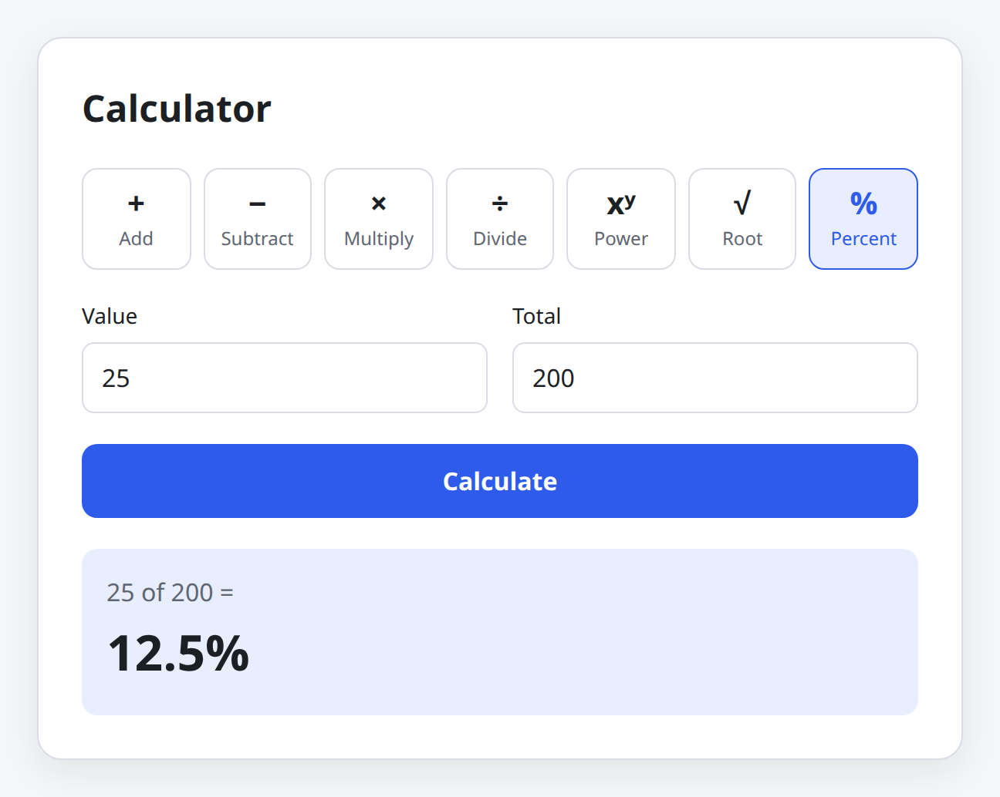

# Calculator

Full-stack calculator with a **React + TypeScript** frontend and a **Go** REST
API. The frontend sends each calculation to the API, which validates the input,
handles edge cases such as division by zero and returns the result as JSON.

<p align="center">
  
</p>

## Contents

- [Features](#features)
- [Tech stack](#tech-stack)
- [Quick start with Docker](#quick-start-with-docker)
- [Running without Docker](#running-without-docker)
- [API usage](#api-usage)
- [Tests and coverage](#tests-and-coverage)
- [Project structure](#project-structure)
- [Design decisions](#design-decisions)
- [Assumptions](#assumptions)
- [Use of AI](#use-of-ai)

More detail on each part:

- [`api/README.md`](api/README.md): endpoints, status codes, every edge case
- [`frontend/README.md`](frontend/README.md): components, scripts, UI decisions

## Features

- **Operations:** addition, subtraction, multiplication, division,
  exponentiation, square root and percentage.
- **Validation on both sides:** the frontend checks the fields before sending,
  and the API rejects invalid or incomplete requests on its own.
- **Edge cases:** division by zero, square root of a negative number, invalid
  powers and results too large for a number all return a clear error message.
- **Responsive UI:** the operation buttons wrap on small screens, and the
  page follows the system light or dark theme.
- **Tests:** 99 backend tests (96.8% coverage) and 50 frontend tests
  (100% line coverage).
- **Docker:** one command runs the whole application.

## Tech stack

| Part      | Technologies                                                     |
| --------- | ---------------------------------------------------------------- |
| Backend   | Go 1.27, gorilla/mux, standard library `net/http`                |
| Frontend  | React 19, TypeScript, Vite                                       |
| Tests     | Go `testing` + `httptest`; Vitest + Testing Library              |
| Container | Docker, Docker Compose, nginx                                    |

## Quick start with Docker

Requires [Docker](https://docs.docker.com/get-docker/) with Docker Compose.

```bash
docker compose up --build
```

| URL                      | What                                   |
| ------------------------ | -------------------------------------- |
| http://localhost:3000    | Calculator                             |
| http://localhost:8080    | API, for calling it directly           |

Stop it with `Ctrl+C`, or `docker compose down` if it runs in the background.

In Docker, nginx serves the frontend and forwards every request under `/api`
to the API container, so the browser talks to a single origin.

## Running without Docker

Requires [Go](https://go.dev/dl/) 1.27+ and [Node.js](https://nodejs.org/)
22.13+ (or 20.19+).

**1. Start the API** (terminal 1):

```bash
cd api
cp .env.example .env
make run              # or: go run .
```

**2. Start the frontend** (terminal 2):

```bash
cd frontend
npm install
npm run dev
```

Open http://localhost:5173.

The defaults work together out of the box: the API listens on port `8080`
and allows calls from `http://localhost:5173`. If you change a port, keep
these settings in sync:

| Setting                         | Where           | Default                 |
| ------------------------------- | --------------- | ----------------------- |
| `API_PORT`                      | `api/.env`      | `8080`                  |
| `ALLOWED_ORIGIN` (CORS)         | `api/.env`      | `http://localhost:5173` |
| `VITE_API_URL`                  | `frontend/.env.local` | `http://localhost:8080` |

## API usage

Every operation is a `POST` with a JSON body. A success returns
`{"result": <number>}` with status `200`, and an error returns
`{"err": "<message>"}`.

| Endpoint                | Body                             | Result                     |
| ----------------------- | -------------------------------- | -------------------------- |
| `POST /addition`        | `{"number1": a, "number2": b}`   | `a + b`                    |
| `POST /subtraction`     | `{"number1": a, "number2": b}`   | `a - b`                    |
| `POST /multiplication`  | `{"number1": a, "number2": b}`   | `a * b`                    |
| `POST /division`        | `{"number1": a, "number2": b}`   | `a / b`                    |
| `POST /exponentiation`  | `{"number1": a, "number2": b}`   | `a` raised to `b`          |
| `POST /percentage`      | `{"number1": a, "number2": b}`   | what percent `a` is of `b` |
| `POST /square-root`     | `{"number": a}`                  | square root of `a`         |

```bash
curl -X POST http://localhost:8080/addition \
  -H "Content-Type: application/json" \
  -d '{"number1": 2, "number2": 3}'
# 200 {"result":5}

curl -X POST http://localhost:8080/division \
  -H "Content-Type: application/json" \
  -d '{"number1": 1, "number2": 0}'
# 422 {"err":"division by zero is not allowed"}

curl -X POST http://localhost:8080/square-root \
  -H "Content-Type: application/json" \
  -d '{"number": -4}'
# 422 {"err":"square root of a negative number is not allowed"}

curl -X POST http://localhost:8080/addition \
  -H "Content-Type: application/json" \
  -d '{"number1": 2}'
# 400 {"err":"number2 is required"}
```

| Status | Meaning                                                  |
| ------ | -------------------------------------------------------- |
| `400`  | Invalid request: missing field, not a number, bad JSON   |
| `404`  | Route not found                                          |
| `405`  | Method other than `POST`                                 |
| `413`  | Body larger than 1 KB                                    |
| `422`  | Valid input that cannot be calculated, e.g. `1 / 0`      |

The full list of edge cases and messages is in the
[API README](api/README.md#edge-cases).

## Tests and coverage

| Part     | Command                            | Tests | Coverage                      |
| -------- | ---------------------------------- | ----- | ----------------------------- |
| Backend  | `cd api && make coverage`          | 99    | 96.8% of statements           |
| Frontend | `cd frontend && npm run coverage`  | 50    | 100% of lines, 97% of branches |

Both commands print the coverage per file and write an HTML report:
`api/coverage.html` and `frontend/coverage/index.html`. To only run the
tests, use `make test` and `npm test`.

What is covered:

- **Backend:** every operation and its edge cases, every handler through
  HTTP (status, body and headers), request validation, CORS, routing,
  `404`/`405` responses and configuration loading.
- **Frontend:** input parsing and result formatting, the API client
  (success, API errors, network failure, invalid responses) and the
  calculator component as a user would use it: choosing an operation,
  typing, submitting with the button or Enter, validation messages, errors
  and the loading state.

## Project structure

```
calc-application/
├── docker-compose.yml       # Runs api + frontend together
├── docs/                    # Images used in this README
├── api/                     # Go REST API
│   ├── main.go
│   ├── Dockerfile
│   └── src/
│       ├── config/          # Settings from .env / environment
│       ├── controllers/     # Operations, HTTP handlers, request decoding
│       ├── middleware/      # CORS and request logging
│       ├── models/          # Input and output types
│       ├── response/        # JSON responses
│       └── router/          # Routes, 404 and 405
└── frontend/                # React app
    ├── Dockerfile
    ├── nginx.conf           # Serves the app, forwards /api to the API
    └── src/
        ├── api/             # API client
        ├── components/      # Calculator component
        ├── utils/           # Number parsing and formatting
        └── operations.ts    # The list of operations shown in the UI
```

## Design decisions

### Architecture

```
Browser ──► React app ──► POST /api/<operation> ──► Go API ──► {"result": …}
```

- **All math happens in the API.** The frontend only collects input, checks
  that it is a number, and shows the result or the error. This keeps the
  rules in one place, as the assignment asks for a backend service.
- **The API validates on its own.** The frontend validation is a convenience
  for the user; the API never trusts its input, so it is safe to call
  directly.

### Backend

- **Operations are separate from HTTP.** The math functions take numbers and
  return a result or an error, so they are tested without any HTTP code.
- **One shared request flow.** Every handler uses the same helper to decode
  and validate the body, so each handler is one line.
- **`400` versus `422`.** `400` means the request is malformed; `422` means
  it is well formed but the math is impossible.
- **Few dependencies.** Only gorilla/mux and godotenv; CORS and validation
  use the standard library.

### Frontend

- **Operations are data.** `operations.ts` lists each operation's endpoint,
  symbol, field labels and how to show the expression. The component reads
  this list, so adding an operation needs no new UI code.
- **The API client is isolated.** `api/calculator.ts` is the only code that
  knows about HTTP. It turns every failure into a message the user can read.
- **Readable results.** Results are rounded to 12 significant digits, so
  `0.1 + 0.2` shows `0.3` instead of `0.30000000000000004`.
- **Accessible.** Labeled fields, `aria-pressed` on the selected operation,
  and results and errors announced to screen readers.

### Docker

- **One origin through nginx.** nginx serves the built app and forwards
  `/api` to the API, so the browser needs no CORS and the API URL is not
  hard-coded. CORS is still configured for local development, where the two
  run on different ports.
- **Small images.** Both use multi-stage builds: the API image holds only the
  compiled binary (about 16 MB) and runs as a non-root user.

## Assumptions

- Numbers are 64-bit floats (`float64` in Go, `number` in TypeScript), which
  covers the range a calculator needs.
- `0` raised to `0` returns `1`, following the usual math convention.
- Percentage answers "what percent of `number2` is `number1`":
  `25` of `200` is `12.5%`.
- There is no authentication, history or persistence: each calculation is
  an independent, stateless request.

## Use of AI

This project was built with the help of
**[Claude Code](https://claude.com/claude-code)**, Anthropic's AI coding
assistant. The author set the requirements, made the design choices, checked
the result in the browser and asked for changes. For example, the operation
buttons were reworked after a screenshot showed them overflowing on a real
screen.

**Backend.** The project structure, routing, operations and handlers were
written by hand. Claude Code was used for:

- **Documentation:** Go doc comments and the README files.
- **Bug fixes:** finding the API's edge cases by sending real requests, and
  fixing them. This covered invalid powers, missing or unknown fields,
  invalid JSON, body size, `404`/`405` in JSON and CORS. It also moved request
  decoding into one shared helper.
- **Tests:** the unit tests and the coverage setup.

**Frontend.** The author defined the layout: a row of operation buttons, the
number fields and a submit button. Claude Code implemented it, made it
responsive and wrote the tests.

**Docker.** Claude Code wrote the Dockerfiles, the nginx configuration and
the Compose file, and made the API's `.env` file optional so it runs in a
container.

### Prompts used

The prompts were written in Portuguese. English translations, in order:

1. "Document the functions and packages of my API."
2. "I want simpler comments."
3. "Regarding the backend points, can we say we completed what was requested,
   based on the experience of a junior developer?" *(with the assignment text)*
4. "How do I solve this CORS issue?"
5. "List the edge cases so that I can solve them."
6. "Give me an error to use in the square root case."
7. "Solve the exponentiation problem."
8. "Check the pending edge cases again."
9. "Solve the pending points."
10. "Write the unit tests with a coverage report."
11. "Write the backend README, emphasizing that Claude Code was the AI used,
    for documentation, small bug fixes and test creation."
12. "Wouldn't it be better to document the backend in the root README?"
13. "Regarding the backend points, are they all finished correctly?"
14. "Now let's move on to the frontend. Which file do I have to edit in React?"
15. "I want you to build a simple screen with this layout: a row of buttons
    with each operation the calculator can perform, the fields to enter the
    numbers and a button to submit. Does that make sense?"
16. "The page is not opening in the browser."
17. "It's not very responsive." *(with a screenshot)*
18. "Can you set up the whole project to run together with Docker, as
    described in the email?"
19. "Write the frontend unit tests with coverage."
20. "Document the project in the READMEs."
